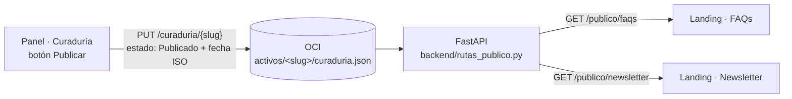

# Landing pública de Insight Mind

Sitio de consulta y ventas: qué es Insight Mind, planes, FAQs y newsletter. Es **otra web**, separada del panel (`frontend/insightmind-v2`), y no exige sesión.

Lo importante: **las FAQs y el newsletter de la landing salen de la curaduría del panel.** Cuando el equipo publica una pieza "Tip / FAQ" o un "Destaque de newsletter", aparece en la sección correspondiente de la landing, sin tocar el HTML.

HTML, CSS y JavaScript sin framework ni build.

---

## 1. Cómo se conecta con la plataforma



1. **Panel → bucket.** En la curaduría, "Publicar" (uno o en lote) marca el activo como `Publicado`, le pone la fecha real en ISO y guarda la curaduría en OCI con `PUT /curaduria/{slug}`. Si el guardado falla, no se da por publicado. "Deshacer" también se guarda.
2. **Bucket → API pública.** `backend/rutas_publico.py` expone dos rutas de solo lectura:

   | Ruta | Devuelve |
   |---|---|
   | `GET /publico/faqs` | activos `formato: "Tip / FAQ"` con `estado: "Publicado"` |
   | `GET /publico/newsletter` | activos `formato: "Destaque de newsletter"` con `estado: "Publicado"` |

   - Recorren **todas** las curadurías del bucket (`activos/*/curaduria.json`) y responden una lista con la misma forma del archivo: `[{slug, periodo_referencia, activos: [{id, formato, estado, publicado, texto}]}]`.
   - **No sale nada privado:** ni tickets, ni `fuente_detalle` (autor, canal y texto original del mensaje), ni activos sin publicar.
   - Son **públicas**: `main.py` agrega `/publico` a `auth.RUTAS_PUBLICAS`. El resto de la API sigue exigiendo sesión.
   - Caché de 60 s en memoria para no leer el bucket en cada visita; cada `PUT /curaduria` la invalida, así que lo recién publicado aparece al recargar.
3. **API → landing.** `js/datos.js` es el único archivo que lee datos. Pide las dos rutas, filtra otra vez por estado y formato, separa la pregunta (la primera línea en `**negrita**`) de la respuesta y convierte el markdown mínimo a HTML escapado.

### Las conexiones "Web" y "Newsletter" del panel

En `backend/gestor_conexiones.py`, **Web de la comunidad** (Tip / FAQ → `/publico/faqs`) y **Newsletter** (Destaque de newsletter → `/publico/newsletter`) son destinos **de la landing**: no piden credenciales y vienen **siempre conectados**. Sus datos (nombre, cuenta, modo y enlace `/landing/#faqs` · `/landing/#newsletter`) salen del código, así que un `backend/conexiones_config.json` viejo en el servidor ya no los deja apagados. Solo se respeta el archivo si alguien las desvincula a mano desde **Conexiones** (queda `"manual": true`); volver a conectarlas las deja de nuevo en la landing.

En **Curaduría**, las pestañas Web y Newsletter muestran el enlace "Ver en la landing" junto al destino.

### Respaldo local

Si la API no responde en 4 segundos, la landing usa `datos/faqs.json` y `datos/newsletter.json`, que tienen la misma forma. Así nunca queda vacía en una demo sin backend. En la consola aparece `[Insight Mind] …: uso el respaldo local`, y `Datos.procedencia` dice de dónde salió cada bloque (`plataforma`, `respaldo local` o `local`).

### Contenido fijado

`datos/fijados.json` tiene 3 FAQs y 1 edición del newsletter que la landing muestra **siempre**, aunque la plataforma todavía no haya publicado nada. Así esas secciones nunca se ven vacías. Usa la misma forma que `curaduria.json`.

- **FAQs:** las fijadas van primero y debajo todo lo publicado desde la curaduría.
- **Newsletter:** se muestran las 3 ediciones más recientes, y la fijada siempre está entre ellas.
- **Sin duplicados:** si la plataforma publica una pieza con el mismo título que una fijada, se ve una sola vez.

Para cambiar lo fijo, edita ese archivo. Si no carga, la landing sigue mostrando lo publicado.

Los planes viven solo en `datos/planes.json`. Los precios son **provisionales**: edita ese archivo cuando estén los definitivos (`"provisional": false` quita el aviso).

---

## 2. Dónde busca la API (sin configurar nada)

`js/datos.js` lo detecta según cómo se sirve la página:

| Cómo se sirve | URL de la landing | API | Botón "Entrar" |
|---|---|---|---|
| nginx (`deploy/desplegar.sh`) | `http://localhost/landing/` | `/api` (mismo origen) | `/` (panel) |
| FastAPI en desarrollo (`SERVIR_UI=1`) | `http://127.0.0.1:8000/landing/` | mismo origen | `/ui/` |
| Suelta (`node frontend/landingpage/servidor.js`) | `http://localhost:5600/` | `http://localhost:8000` | `http://localhost:8000/ui/` |

Para forzar otra API, agrega en `index.html`: `<meta name="im-api" content="https://tu-api">`.

---

## 3. Ejecutar

**Con nginx (despliegue):** `./deploy/desplegar.sh` copia la landing a `/var/www/insightmind/landing/`. Queda en `http://localhost/landing/`.

**Desarrollo con FastAPI:**

```bash
SERVIR_UI=1 uvicorn main:app --host 127.0.0.1 --port 8000
```

Abre `http://127.0.0.1:8000/landing/`.

**Solo la landing** (sin backend: usa el respaldo local):

```bash
node frontend/landingpage/servidor.js 5600
```

Para que, servida así, lea la API real, define en el `.env` del backend `CORS_ORIGINS=http://localhost:5600`.

**Probar el endpoint** (sin OCI: usa un bucket falso):

```bash
python pruebas/prueba_publico.py
```

**Probar de punta a punta:** publica una FAQ o un destaque de newsletter en la curaduría del panel y recarga la landing.

---

## 4. Estructura

```text
frontend/landingpage/
├── index.html        # una sola página: Información, Planes, FAQs, Newsletter
├── css/sitio.css     # tokens del panel (claro/oscuro) + estilos de la landing
├── css/fuentes.css   # @font-face de las fuentes alojadas en fuentes/
├── js/datos.js       # TODA la lectura de datos: API, respaldo, markdown mínimo
├── js/sitio.js       # tema, anclas, planes, acordeón de FAQs, ediciones, formulario, animaciones
├── js/legal.js       # tema en las páginas legales
├── legal/            # aviso de privacidad, aviso para comunidades, términos y cookies
├── fuentes/          # Schibsted Grotesk e IBM Plex Mono (woff2, SIL OFL), sin Google Fonts
├── datos/            # respaldo local (forma de curaduria.json), fijados.json y planes.json
├── img/
│   ├── hero-claro.*  # foto del hero, tema claro: .avif y .jpg, en 2000 y 1000 px
│   ├── hero-oscuro.* # foto del hero, tema oscuro (alineada con la clara, ver sección 5)
│   └── isotipo.svg   # favicon
└── servidor.js       # servidor estático mínimo (puerto 5600)
```

## 5. Diseño y animaciones

- **Sistema visual del panel:**
  - Mismos tokens de color: claro, oscuro por sistema y oscuro o claro elegido a mano.
  - Schibsted Grotesk e IBM Plex Mono.
  - Radios de 9 y 13 px y un solo acento.

### Hero

- **Imagen:** una escultura de papel. Las burbujas de la comunidad fluyen hacia una hoja que una mano sostiene: de ruido a señal, y tu equipo decide. Es una imagen generada con IA.
- **Composición:**
  - En escritorio la foto vive detrás del texto, con el borde izquierdo difuminado.
  - En una columna va arriba, a todo el ancho, y el titular se empalma sobre su mitad inferior, como una portada.
- **Dos fotos, una por tema, alineadas al píxel:**
  - La oscura se reescaló y desplazó para que la hoja y la mano caigan exactamente sobre las de la clara: la hoja ocupa 1464,330 → 1781,783 en las dos.
  - Al cambiar de tema se funden una en la otra sin saltos.
  - Si se reemplazan, hay que mantener esa alineación y el lienzo de 2000 × 1116.
- **Texto sobre la foto:**
  - En claro va sólido, con un halo del color del fondo que lo separa de las burbujas.
  - En oscuro va al 95 %.
  - El halo solo aparece cuando el fondo ya es claro, para que no "brille" durante el cambio de tema.
- **Formatos:** AVIF (unos 32 KB en 2000 px y 12 KB en 1000 px), con JPEG de respaldo para navegadores sin AVIF. `<picture>` y `srcset` hacen que cada pantalla descargue solo el tamaño que necesita.

### Animaciones

Todas se apagan con `prefers-reduced-motion`, y sin JavaScript todo se ve igual.

- **Entrada:** el texto del hero sube apenas y la foto solo se funde, sin moverse.
- **Cambio de tema:**
  - Toda la página se funde a la vez en 700 ms: colores, bordes y foto.
  - Las transiciones solo se activan durante el cambio (clase `.cambiando-tema`), para no frenar el resto de la interfaz.
- **Scroll:**
  - Los bloques se revelan escalonados.
  - La línea de "Cómo funciona" se dibuja paso a paso.
  - El isotipo entra con escala suave.
- **FAQs:** la respuesta entra con un fundido y un leve desenfoque al desplegarse.
- **Modal del boletín:**
  - El fondo se tiñe y se desenfoca.
  - La ventana sube, se enfoca y aparece.
  - Su contenido llega escalonado.
  - Al cerrar todo es más rápido.
- **Cambio de página:** fundido con desenfoque (View Transitions entre documentos).
  - Funciona entre páginas del mismo origen que declaren `@view-transition`.
  - En navegadores sin soporte, navega normal.
- **Estela del cursor:**
  - Una estela morada muy tenue y difusa (desenfoque de 7 px) que sigue el trayecto del ratón.
  - Mide lo que el cursor en la punta y se afila hacia la cola; un trazo largo deja una estela más larga.
  - Cada tramo se apaga en 1 s.
  - Solo con ratón: no aparece en pantallas táctiles.
  - El bucle de dibujo se detiene en reposo.
  - Se ajusta con `ANCHO` y `ALFA` en `js/sitio.js` y con el `blur` de `.rastro` en `css/sitio.css`.
- **Planes:** se elevan un poco al pasar el cursor.

### Rendimiento (medido en local, escritorio)

| Métrica | Valor |
|---|---|
| Peso total de la página | ~161 KB, sin las fuentes de Google |
| Fotos del hero | 64 KB las dos en escritorio; ~25 KB en móvil |
| Carga completa | ~270 ms |
| CLS (saltos de diseño) | 0 |
| Tareas largas | 0 |

## 6. Legal

- **Páginas, enlazadas en el pie:**
  - `legal/privacidad.html`: sitio y boletín.
  - `legal/comunidad.html`: para los miembros de las comunidades cuyas conversaciones se analizan.
  - `legal/terminos.html`.
  - `legal/cookies.html`.
- **Sin cookies ni terceros:** las fuentes se sirven desde `fuentes/` y no hay analítica. Por eso no hace falta banner de cookies. Lo único que guarda el navegador es el tema (`im-sitio-tema`).
- **Boletín:** junto al botón hay un aviso de consentimiento. Al conectar el envío real hay que guardar la prueba del consentimiento y confirmar por correo (ver el `TODO` en `js/sitio.js`).
- **Transparencia:** FAQs y newsletter avisan que se redactan con IA y que una persona los revisa. Los planes avisan que son ilustrativos.
- **Datos por completar:** lo que aparece subrayado en amarillo en las páginas legales (correo de contacto, regiones, plazos) son datos pendientes. La lista completa está en `docs/legal/README.md`.

## 7. Pendientes

- **Suscripción al newsletter:** hoy solo confirma en pantalla. Ver el `TODO` en `js/sitio.js` para conectarla a un servicio real.
- **Precios:** son definitivos solo cuando se editen en `datos/planes.json`.
- **Botón "Conocer el panel" del plan Organización:** cambiarlo por un contacto de ventas cuando exista.
