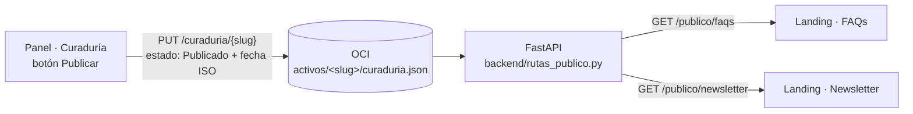

# Landing pública de Insight Mind

Sitio de consulta y ventas: qué es Insight Mind, planes, FAQs y newsletter. Es **otra web**, separada del panel (`frontend/insightmind-v2`), y no exige sesión.

Lo importante: **las FAQs y el newsletter de la landing salen de la curaduría del panel.** Cuando el equipo publica una pieza "Tip / FAQ" o un "Destaque de newsletter", aparece en la sección correspondiente de la landing, sin tocar el HTML.

HTML, CSS y JavaScript sin framework ni build.

---

## 1. Cómo se conecta con la plataforma



1. **Panel → bucket.** En la curaduría, "Publicar" (uno o en lote) marca el activo como `Publicado`, le pone la fecha real en ISO y guarda la curaduría en OCI con `PUT /curaduria/{slug}`. Si el guardado falla, no se da por publicado. "Deshacer" también se guarda.
2. **Bucket → API pública.** `backend/rutas_publico.py` expone dos rutas de solo lectura:

   | Ruta | Devuelve |
   |---|---|
   | `GET /publico/faqs` | activos `formato: "Tip / FAQ"` con `estado: "Publicado"` |
   | `GET /publico/newsletter` | activos `formato: "Destaque de newsletter"` con `estado: "Publicado"` |

   - Recorren **todas** las curadurías del bucket (`activos/*/curaduria.json`) y responden una lista con la misma forma del archivo: `[{slug, periodo_referencia, activos: [{id, formato, estado, publicado, texto}]}]`.
   - **No sale nada privado:** ni tickets, ni `fuente_detalle` (autor, canal y texto original del mensaje), ni activos sin publicar.
   - Son **públicas**: `main.py` agrega `/publico` a `auth.RUTAS_PUBLICAS`. El resto de la API sigue exigiendo sesión.
   - Caché de 60 s en memoria para no leer el bucket en cada visita; cada `PUT /curaduria` la invalida, así que lo recién publicado aparece al recargar.
3. **API → landing.** `js/datos.js` es el único archivo que lee datos. Pide las dos rutas, filtra otra vez por estado y formato, separa la pregunta (la primera línea en `**negrita**`) de la respuesta y convierte el markdown mínimo a HTML escapado.

### Las conexiones "Web" y "Newsletter" del panel

En `backend/gestor_conexiones.py`, **Web de la comunidad** (Tip / FAQ → `/publico/faqs`) y **Newsletter** (Destaque de newsletter → `/publico/newsletter`) son destinos **de la landing**: no piden credenciales y vienen **siempre conectados**. Sus datos (nombre, cuenta, modo y enlace `/landing/#faqs` · `/landing/#newsletter`) salen del código, así que un `backend/conexiones_config.json` viejo en el servidor ya no los deja apagados. Solo se respeta el archivo si alguien las desvincula a mano desde **Conexiones** (queda `"manual": true`); volver a conectarlas las deja de nuevo en la landing.

En **Curaduría**, las pestañas Web y Newsletter muestran el enlace "Ver en la landing" junto al destino.

### Respaldo local

Si la API no responde en 4 segundos, la landing usa `datos/faqs.json` y `datos/newsletter.json`, que tienen la misma forma. Así nunca queda vacía en una demo sin backend. En la consola aparece `[Insight Mind] …: uso el respaldo local`, y `Datos.procedencia` dice de dónde salió cada bloque (`plataforma`, `respaldo local` o `local`).

Los planes viven solo en `datos/planes.json`. Los precios son **provisionales**: edita ese archivo cuando estén los definitivos (`"provisional": false` quita el aviso).

---

## 2. Dónde busca la API (sin configurar nada)

`js/datos.js` lo detecta según cómo se sirve la página:

| Cómo se sirve | URL de la landing | API | Botón "Entrar" |
|---|---|---|---|
| nginx (`deploy/desplegar.sh`) | `http://localhost/landing/` | `/api` (mismo origen) | `/` (panel) |
| FastAPI en desarrollo (`SERVIR_UI=1`) | `http://127.0.0.1:8000/landing/` | mismo origen | `/ui/` |
| Suelta (`node frontend/landingpage/servidor.js`) | `http://localhost:5600/` | `http://localhost:8000` | `http://localhost:8000/ui/` |

Para forzar otra API, agrega en `index.html`: `<meta name="im-api" content="https://tu-api">`.

---

## 3. Ejecutar

**Con nginx (despliegue):** `./deploy/desplegar.sh` copia la landing a `/var/www/insightmind/landing/`. Queda en `http://localhost/landing/`.

**Desarrollo con FastAPI:**

```bash
SERVIR_UI=1 uvicorn main:app --host 127.0.0.1 --port 8000
```

Abre `http://127.0.0.1:8000/landing/`.

**Solo la landing** (sin backend: usa el respaldo local):

```bash
node frontend/landingpage/servidor.js 5600
```

Para que, servida así, lea la API real, define en el `.env` del backend `CORS_ORIGINS=http://localhost:5600`.

**Probar el endpoint** (sin OCI: usa un bucket falso):

```bash
python pruebas/prueba_publico.py
```

**Probar de punta a punta:** publica una FAQ o un destaque de newsletter en la curaduría del panel y recarga la landing.

---

## 4. Estructura

```text
frontend/landingpage/
├── index.html        # una sola página: Información, Planes, FAQs, Newsletter
├── css/sitio.css     # tokens del panel (claro/oscuro) + estilos de la landing
├── js/datos.js       # TODA la lectura de datos: API, respaldo, markdown mínimo
├── js/sitio.js       # tema, anclas, planes, acordeón de FAQs, ediciones, formulario, animaciones
├── datos/            # respaldo local con la forma de curaduria.json + planes
├── img/isotipo.svg   # favicon
└── servidor.js       # servidor estático mínimo (puerto 5600)
```

## 5. Diseño y animaciones

- **Sistema visual del panel:** mismos tokens de color (claro, oscuro por sistema y elegido a mano), Schibsted Grotesk e IBM Plex Mono, radios de 9 y 13 px, y un solo acento.
- **Animaciones** (todas se apagan con `prefers-reduced-motion`, y sin JS todo se ve igual):
  - entrada del hero;
  - revelado escalonado de bloques al hacer scroll;
  - la línea de "Cómo funciona" se dibuja paso a paso;
  - el isotipo entra con escala suave;
  - la ilustración del hero flota lentamente;
  - los planes se elevan al pasar el cursor.
- **Ilustración del hero:** "Public discussion" de [unDraw](https://undraw.co) (Katerina Limpitsouni), con licencia libre y recoloreada con los tokens. Es de relleno: se puede cambiar por una propia.

## 6. Pendientes

- **Suscripción al newsletter:** hoy solo confirma en pantalla. Ver el `TODO` en `js/sitio.js` para conectarla a un servicio real.
- **Precios:** son definitivos solo cuando se editen en `datos/planes.json`.
- **Botón "Conocer el panel" del plan Organización:** cambiarlo por un contacto de ventas cuando exista.
